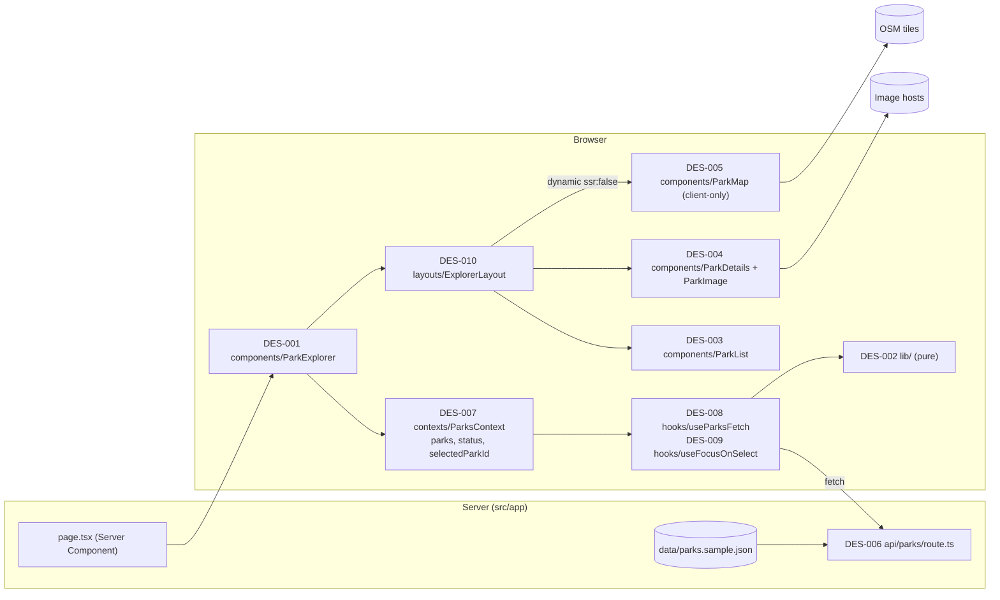
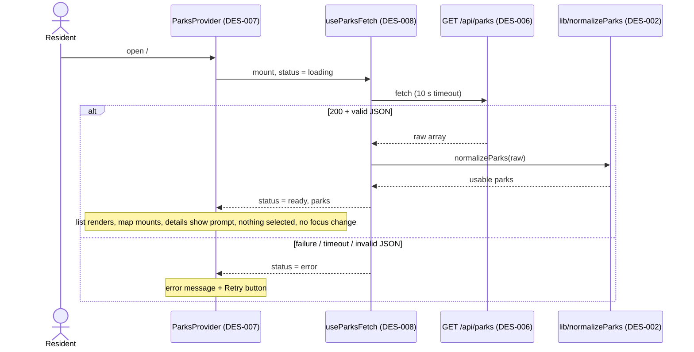
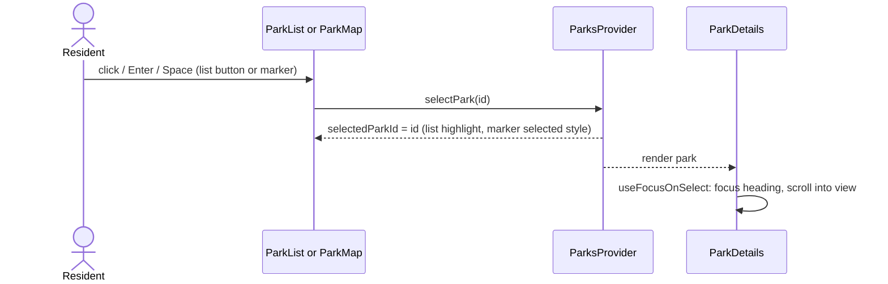

# Software Design Document: parks-explorer
_Date: 2026-10-02_

## Section 1 — Introduction & Purpose

### 1.1 Background
Residents have a supplied dataset of 12 parks (`src/data/parks.sample.json`) but no way to browse it, read details, or see locations. The repository is a fresh create-next-app scaffold (Next.js 16.3.8, React 19.2.8, Tailwind v4, TypeScript strict) with no feature code. This SDD describes how a single-page Next.js app will satisfy the approved requirements using **Approach A**: a client-side explorer that fetches `GET /api/parks`, normalizes the data with pure helpers, and drives the list, map, and details from one `selectedParkId`.

Approaches considered: **A** client explorer with pure helpers (chosen); **B** Server Component reading the JSON directly (rejected: the UI would never call `/api/parks`, so the AC-009 error and retry path is unreachable); **C** URL-synced selection store (rejected: not required, adds `useSearchParams`/Suspense complexity and risks focus side effects on load).

### 1.2 Scope
- One page (`/`) with `ParkList`, `ParkMap`, and `ParkDetails` under `src/components`.
- One Route Handler, `GET /api/parks`, serving the supplied JSON unmodified.
- Pure data helpers (usable-record filter, coordinate validation, display formatting).
- Responsive stacked and side-by-side layout, keyboard and screen-reader support, failure handling for API, tiles, and images.
- A `README.md` replacing the scaffold's, and the test strategy that proves each acceptance criterion.

### 1.3 Out of Scope
Search, filters, ratings-based sorting, geolocation, database, CRUD, authentication, server-side filtering, URL-synced selection, caching layers, telemetry, and CI configuration. Public-deployment concerns (tile provider, image hosting) are documented in the README, not built.

### 1.4 Requirements Baseline
- Requirements: `docs/requirement/requirements.md`, sha256 prefix `9de8b75c23bc` (REQ-F-001 to 013, REQ-NF-001 to 005, CON-001 to 005, AC-001 to 015, Q-001 to Q-007 resolved).
- Analysis: `docs/analysis/requirements_analysis_parks-explorer-2026-10-02.md`, Human Quality Gate **Approved** for that revision (2026-10-02 16:36).
- Stable IDs are preserved and not restated as prose; Section 11 maps every ID to a `DES-*` item.
- Analysis items D-01 to D-06 are resolved in Sections 2, 7, and 8. D-06: `react-leaflet@5.0.0` has peer dependencies `react ^19`, `leaflet ^1.9`.
- Project convention (user-mandated, recorded in `AGENTS.md`): non-route code lives in `src/assets`, `components`, `contexts`, `data`, `hooks`, `layouts`, `lib`.

## Section 2 — System Architecture

### 2.1 High-Level Architecture

### 2.2 Components and file placement
| Folder | Contents |
|---|---|
| `src/app/` | `page.tsx` (renders `ParkExplorer`), `layout.tsx` (scaffold "Create Next App" title and description replaced with real metadata), `globals.css`, `api/parks/route.ts` (DES-006). Required by Next.js routing. |
| `src/components/` | `ParkExplorer` (DES-001), `ParkList` (DES-003), `ParkDetails` + `ParkImage` (DES-004), `ParkMap` (DES-005). |
| `src/contexts/` | `ParksContext.tsx` (DES-007): provider holding `parks`, `status`, `selectedParkId`, `selectPark`, `retry`. The single source of truth. |
| `src/hooks/` | `useParks` (context accessor with guard), `useParksFetch` (DES-008: fetch, 10 s timeout, retry; aborts on cleanup and ignores any response that is not from the latest request, so React StrictMode double-effects, Retry, and unmount cannot apply stale data), `useFocusOnSelect` (DES-009: focus and scroll on selection change, never on mount; feature-checks `scrollIntoView` and `matchMedia` before use). |
| `src/layouts/` | `ExplorerLayout.tsx` (DES-010): responsive shell taking list, map, and details as slots in DOM order list → map → details. Stacked below `lg`; at `lg` and above, two columns: list on the left, map above details on the right, so tab order equals visual order. Also owns the page landmarks (see DES-020). |
| `src/lib/` | DES-002: `types.ts`, `parks.ts` (`normalizeParks`, `hasValidCoordinates`, `getMarkerParks`), `format.ts` (amenity, acres, rating strings), `api.ts` (`fetchParks`), `fixtures/` (test fixture builder). All DOM-free. |
| `src/data/` | `parks.sample.json` (exists; never edited). |
| `src/assets/` | Only the image-fallback icon (SVG), if one is needed. Empty otherwise. |

Tests sit beside the source as `*.test.ts(x)`. There is no root `e2e/` folder: end-to-end checks are manual (see Section 7).

### 2.3 Interfaces
| Interface | Producer → consumer | Contract | Auth / versioning | Failure semantics |
|---|---|---|---|---|
| `GET /api/parks` | DES-006 → DES-008 via DES-017 | HTTP JSON array of park records | none / none | Non-2xx, network error, invalid JSON, non-array, or 10 s timeout → error state with user-initiated Retry |
| Context and hooks | `ParksContext` → children via `useParks()` | typed state and actions (DES-015) | n/a | Unknown `selectedParkId` → neutral prompt |
| OSM tiles | OSM → DES-005 | `{s}.tile.openstreetmap.org/{z}/{x}/{y}.png`, attribution required | none | Tile errors affect only the map; one non-blocking notice |
| Image URLs | data hosts → DES-004 | `http(s)` URLs only | none | `error` event → per-image fallback block |

No events, storage, or operator interfaces exist. Ownership: this repository owns everything except OSM and image hosts.

### 2.4 Architecture Principles
1. One source of truth: `selectedParkId` lives only in `ParksContext`.
2. Pure core, thin shell: all rules in `lib/`; side effects only in hooks and the context.
3. The map is progressive enhancement; list and details never depend on it.
4. Render only supplied facts; treat data as untrusted input.
5. Code lives in the mandated `src/` folders; no new top-level folders without approval.

## Section 3 — Workflow / Use Cases

### 3.1 DES-011 Initial load

An empty result after normalization is `ready` with zero parks and shows a distinct "no parks available" message (AC-015a). While loading, a `role="status"` "Loading parks…" message is shown; the error view uses `role="alert"`. `useParksFetch` aborts the in-flight request on cleanup and ignores responses from superseded requests.

### 3.2 DES-012 Selecting a park (list or marker)

`selectPark` also increments a focus-request counter, so re-activating the already selected park still returns focus to the details heading. An id not found in `parks` shows the neutral prompt.

### 3.3 DES-013 Failure and degradation paths
- **API failure:** error view; Retry re-runs DES-008; no automatic retry.
- **Tile failure:** non-blocking notice under the map; markers, list, and details keep working.
- **Image failure:** per-image fallback block in `ParkImage`; other images unaffected.
- **No valid coordinates:** park stays in list and details; excluded from markers. With zero marker parks the map shows a default view and no markers; with one, it centres on it.
- **Geolocation:** never called anywhere (AC-007, REQ-F-010).

## Section 4 — Data Models

No persistence layer. Models are TypeScript types in `src/lib/types.ts`, plus the normalization contract that turns raw JSON into them.

### 4.1 DES-014 Raw record and normalized `Park`
The API and sample file carry the **raw** shape (top-level array, 12 records today). The client never trusts it: `normalizeParks(raw: unknown)` produces `Park[]`.

| `Park` field | Type | Normalization rule |
|---|---|---|
| `id` | `string` | Required, trimmed, non-empty. First occurrence wins on duplicates. |
| `name` | `string` | Required, trimmed, non-empty. |
| `description` | `string \| null` | Non-string, empty, or whitespace-only → `null`. |
| `address` | `string \| null` | From `location.address`, same rule as `description`. |
| `coordinates` | `{ lat: number; lng: number } \| null` | Non-null only if both are finite numbers, lat in [-90, 90], lng in [-180, 180] (Q-003). Markers are exactly the parks where it is non-null. |
| `amenities` | `string[]` | Non-array → `[]`; non-string or empty entries dropped. |
| `hours` | `string \| null` | Same text rule; shown verbatim. |
| `images` | `string[]` | Non-array → `[]`; only absolute `http:` and `https:` URLs kept (relative URLs and other schemes are dropped). |
| `acreage` | `number \| null` | Finite and ≥ 0, else `null`. |
| `rating` | `number \| null` | Finite number, else `null`. |

Unknown extra fields are dropped, not rendered. Records without a usable `id` or `name` are excluded (Q-002, AC-015c). Whitespace-only values are treated as empty; this clarifies "non-empty" and is not a requirement change.

### 4.2 DES-015 Provider state (`ParksContext`)
| Field | Type | Notes |
|---|---|---|
| `status` | `'loading' \| 'error' \| 'ready'` | Error carries a user-safe message. |
| `parks` | `Park[]` | Empty until `ready`; may be empty after. |
| `selectedParkId` | `string \| null` | `null` on first load (Q-007). |
| `focusRequest` | `number` | Incremented on every `selectPark`, so reselection refocuses. |

`selectedPark` is derived by `id` lookup, never stored. Marker parks are derived from `coordinates !== null`, so list and map cannot disagree.

## Section 5 — API Endpoints

### 5.1 DES-016 `GET /api/parks`
| Aspect | Design |
|---|---|
| File | `src/app/api/parks/route.ts` (Route Handler, `GET` only) |
| Request | No params, body, or auth |
| Success | `200`, `Content-Type: application/json`, body = `src/data/parks.sample.json` unmodified (top-level array; 5,910 bytes today) |
| Data access | Static `import` of the JSON: no runtime file-system access, no user-controlled path |
| Validation | None on the server; the body must deep-equal the file (AC-009). Validation happens client-side (DES-002) |
| Auth / versioning | None / none |
| Other methods | Not exported, so Next.js answers `405` |
| Errors | No catch. Unexpected failure is Next's default `500` with no stack trace in production. The UI treats every non-2xx the same way |
| Caching | Framework defaults; no explicit cache headers |

No other endpoints exist; none for CRUD or filtering.

### 5.2 DES-017 Client call (`lib/api.ts` → `fetchParks`)
Used only by `useParksFetch` (DES-008).
- `GET /api/parks` with `cache: "no-store"`, so Retry always re-requests.
- `AbortController` aborts after 10 s.
- Success requires `res.ok`, parseable JSON, and an array.
- Throws on network error, timeout, non-2xx, invalid JSON, or non-array; `useParksFetch` turns every throw into `status = 'error'` with one user-safe message (no raw error text shown).
- Retry is user-initiated only: no automatic retry, stacking, or backoff.

## Section 6 — Non-functional Requirements

Checklist items this app does not need are marked N/A with a reason.

| Area | Design decision |
|---|---|
| **Performance** (DES-018) | No latency or throughput target in the requirements, so none is invented. Practical budget: 12 records, 5.9 KB payload, no pagination (fixed small dataset; the README lists this as a limit). `ParkMap` is code-split via `dynamic`, so the list renders without loading Leaflet. Images use `loading="lazy"`. The context value and callbacks are memoized, and the two marker icons (default, selected) are created once at module level, so a selection change does not rebuild every marker. Load, stress, and soak tests: N/A. |
| **Security** (DES-019) | No auth, PII, secrets, or user input. Controls: image URLs limited to `http(s)` (DES-014); React text rendering only, never `dangerouslySetInnerHTML`; `referrerPolicy="no-referrer"` on images; static JSON import, so no path traversal. New runtime and dev dependencies need review approval per `AGENTS.md`. CSP, CORS, HSTS, rate limiting: N/A locally, listed in the README as pre-public work. |
| **Consistency** | N/A: read-only static data, one client state owner (DES-007). Re-activating the selected park still refocuses the details (DES-012). |
| **Availability** | No SLO invented. Degradation ladder (DES-013): tiles fail → list and details work; API fails → error plus Retry; image fails → fallback block. Multi-region, failover, backups: N/A. |
| **Scalability / Cost** | N/A for 12 records and zero infrastructure. OSM public tiles are free but unsuitable for public traffic (RISK-002); the README requires a reviewed provider plan before public use. |
| **Reliability** | Every failure class maps to one UI state (DES-013). 10 s fetch timeout (DES-017). Edge cases (empty data, 0 or 1 marker, bad or duplicate records, long text) are handled by DES-014 and AC-015; long strings wrap (`break-words`, `min-w-0`) to prevent horizontal scroll. Retries, circuit breakers, dead-letter queues: N/A. |
| **Observability** (DES-022) | No metrics, tracing, or alerting. A single `console.error` in the fetch-failure path, and in development a `console.warn` with the count of records dropped by `normalizeParks`. |
| **Accessibility and layout** (DES-020) | **Page shell:** one `<h1>`, a `<main>` landmark, and labelled `<section>`s for the list ("Parks"), the map ("Parks map"), and the details; scaffold metadata replaced. **List:** `<button>`s in a `<ul>`, `aria-current` on the selected one. **Details:** heading focusable (`tabindex="-1"`). **Selected state** (list item and marker) uses a non-colour cue (border/weight on the item, size or ring on the marker) as well as colour. `focus-visible:` rings on controls. Text contrast ≥ 4.5:1; scrolling honours `prefers-reduced-motion`. **No nested scroll containers:** the page scrolls. **Images** sit in fixed aspect-ratio boxes so loaded and fallback states do not shift layout. Stacked below `lg`; at `lg`, list left and map above details on the right (DOM order = visual order). Map wrapper has an explicit Tailwind height (REQ-NF-005). |
| **Theme** (DES-021) | Light theme only: OSM tiles are always light and AC-013 would otherwise need two themes. Removes the scaffold's `prefers-color-scheme: dark` block and sets `color-scheme: light`. (Approved.) |

## Section 7 — Test Strategy (DES-023)

End-to-end checks are performed **manually by the project owner**; automated tests use Vitest and React Testing Library only (see DES-024).

### 7.1 Requirement Coverage
Each AC has exactly one primary level. Secondary levels appear only where they prove a distinct risk. Fixtures are built in code by cloning sample records; `parks.sample.json` is never edited.

| AC | DES | Verification boundary | Observable fact / prohibited outcome | Primary | Secondary and why | Deterministic data | Measurement / tolerance | Evidence |
|---|---|---|---|---|---|---|---|---|
| AC-001 | 001, 003, 007, 011, 012 | Rendered UI | 12 items for the sample; nothing highlighted and prompt shown on load; heading equals activated park's name | integration | none | Sample + mocked fetch | Exact counts and strings | Vitest report |
| AC-002 | 005, 012, 025, 026 | Real browser map | Marker count = valid parks; all markers inside initial bounds; click selects same ID | e2e (manual) | integration: marker count and selection, so regressions are caught without a browser | Sample via real API | Exact count; bounds containment by inspection | Manual checklist result + Vitest report |
| AC-003 | 002, 014 | Rendered UI | Invalid-coordinate park listed, selectable, no marker | integration | unit: table of invalid values (string, null, NaN, ±Infinity, out of range) | Cloned records with mutated `location` | Exact | Vitest report |
| AC-004 | 004, 014, 029 | Rendered UI | No exception; every string traces to a source field or a "not provided" label; image fallback shown | integration | unit: formatters | Cloned sparse records; fired `error` on `` | Exact | Vitest report |
| AC-005 | 003, 009, 020 | Keyboard in jsdom, plus real browser for focus ring | Tab reaches control; Enter/Space selects; `activeElement` = details heading | integration (`user-event`) | e2e (manual): focus ring is visible, since jsdom cannot compute CSS | Sample | Exact; ring non-none by inspection | Vitest report + manual walkthrough note |
| AC-006 | 010, 020, 027 | Real browser at 375 and 1280 px | No horizontal scroll; stacked vs side-by-side | e2e (manual) | none | Sample, long-name fixture | `scrollWidth <= clientWidth` | Screenshots at both widths + scroll check |
| AC-007 | 013, 008 | Browser API calls | Zero `navigator.geolocation` access | integration | none (static code search recorded as review note) | Sample, spy | Call count = 0 | Vitest report |
| AC-008 | 005, 013, 028 | Leaflet `tileerror` in Vitest | Notice appears; list and details still pass the AC-001 flow | resilience | e2e (manual): block `tile.openstreetmap.org` in DevTools | Simulated `tileerror` event | Pass/fail | Vitest report + manual note |
| AC-009 | 006, 008, 016, 017 | HTTP handler, then UI | 200, JSON content type, body deep-equals the file **read from disk** (not the same import); forced failure shows message + Retry that re-requests | integration | resilience: failure and recovery path in the UI; e2e (manual): block `/api/parks` in DevTools, see error and Retry, unblock, Retry loads parks | Handler called directly in the node test environment; mocked failing then succeeding fetch | Exact | Vitest report + manual note |
| AC-010 | 031 | Repository files | Required README sections and OSM caveat present | integration (doc-structure check) | none | README | Heading checklist | Test output + clean-checkout run note |
| AC-011 | 004, 014, 030 | Rendered UI | Exact verbatim and formatted strings for `prospect-park` | integration | unit: formatters | Sample record | Exact string match | Vitest report |
| AC-012 | 005, 009, 012 | Rendered UI | One selected list item, one selected marker, `activeElement` = heading | integration | e2e (manual): heading within the viewport | Sample | Exact; viewport by inspection | Vitest report + manual note |
| AC-013 | 020, 021 | Real browser, axe extension | 0 violations in initial and selected states; contrast ≥ 4.5:1 | e2e (manual axe DevTools extension scan) | integration: `vitest-axe` for names, roles, ARIA | Sample | Violation count = 0 | Extension report + Vitest report |
| AC-014 | 005, 018, 020 | Production build and browser | Build exits 0; no `window`-undefined errors; map height > 0 at both widths | e2e (manual) | none | `npm run build` + `npm start` | Exit code; height px > 0 | Build log, server log excerpt, measured heights |
| AC-015 | 001, 005, 014, 026, 030 | UI and repo files | Empty-data message; 0/1 marker; excluded or duplicate records; components and attribution present | integration | unit: `normalizeParks` cases | Cloned fixtures | Exact | Vitest report + dependency review note |

### 7.2 Test Levels and Boundaries
| Level | Owns here |
|---|---|
| Unit | `src/lib` pure logic |
| Integration | Component-style tests across owned components, the Route Handler, and repository structure checks |
| Contract | N/A: single in-repo consumer |
| End-to-end | Manual, in a real browser, run by the project owner |
| Security | DES-019 has no AC; justified by untrusted data. A unit test covers the `http(s)`-only image filter |
| Performance | N/A: no performance requirement |
| Resilience | Tile, API, and image failure and recovery |

### 7.3 Test Data and Determinism
A fixture builder in `src/lib/fixtures/` clones sample records. Tests mock `fetch`, simulate Leaflet `tileerror`, and fire `error` on images. No clocks or randomness are involved. jsdom has no layout, so viewport, bounds, contrast, and focus-ring claims are verified manually. If Leaflet proves unreliable in jsdom, `ParkMap` is mocked at the explorer boundary and marker behaviour is tested in its own file; this is checked during implementation. Test setup: the Vitest config maps the `@/*` alias and enables the React plugin; the API test declares the node environment; `next/dynamic` is mocked or resolved synchronously in component tests; jsdom lacks `scrollIntoView` and `matchMedia`, so `useFocusOnSelect` feature-checks them and tests stub them where they assert scrolling. Marker keyboard activation (Enter and Space) is verified against the installed Leaflet 1.9.4, because the reachable Leaflet docs describe a newer branch.

### 7.4 Positive, Negative, and Failure Paths
Positive: AC-001, 002, 011, 012. Negative: AC-003, 004, 015. Failure and recovery: AC-008, AC-009 (API error → Retry succeeds), image error.

### 7.5 Execution and Evidence
Scripts (to be added, not existing today): `npm test` (Vitest). Existing: `npm run lint`, `npm run build`. There is no `test:e2e`. There is no CI, so results go in the README Verification section with exact commands, outcomes, and a dated pass/fail for each manual e2e item (AC-002, AC-005 focus ring, AC-006, AC-008, AC-009 error path, AC-012, AC-013, AC-014). An independent reviewer reruns the same commands and manual steps and compares against the exact assertions above. Risk accepted: AC-002, 006, 013, and 014 cannot be re-checked automatically.

## Section 8 — Design Decisions & Tradeoffs

| ID | Decision | Options considered | Recommendation and rationale | Tradeoff |
|---|---|---|---|---|
| DES-024 (D-01) | Test tooling | (a) Vitest + React Testing Library, no browser automation; (b) Vitest + RTL + Playwright + axe; (c) Jest + RTL + Cypress | **(a), per the project owner's decision.** Vitest with `user-event`, `jest-dom`, `jsdom`, `@vitejs/plugin-react`, and `vitest-axe` (to be verified at install). The owner runs end-to-end checks manually. | Fewer dependencies, but jsdom has no layout, real Leaflet viewport, or computed contrast, so those checks are manual. Vitest 5 asks for `@types/node` ^22 or ≥24 while the project has ^20, so that devDependency is bumped. |
| DES-025 (D-02) | Marker icons | (a) Leaflet default image icons with asset imports; (b) Tailwind-styled `divIcon` | **(b).** Avoids the bundler icon-path problem, needs no assets, gives selected and unselected styling directly. Details: `className: ""` to remove Leaflet's default `.leaflet-div-icon` box; Tailwind classes written as literal strings so Tailwind generates them; each marker has a unique `title` plus visually hidden park-name text in the icon HTML (Leaflet's own guidance for `divIcon` labels); the selected marker differs by size or ring, not colour alone; `keyboard: true` (tabindex 0, role button). | Custom markup to maintain. Enter and Space activation is verified on Leaflet 1.9.4 during implementation; if Space does not activate a marker, a small `keydown` handler on the icon element is added. |
| DES-026 (D-03) | Initial map view | (a) Mount the map after data is ready and pass `bounds`; (b) always mount and call `fitBounds` from a child | **(a).** `MapContainer` `bounds` are fixed after first render and data is fixed after `ready`, so (a) is simpler. 0 marker parks → world view; 1 → centred at zoom 14. | The map is not mounted while loading or in error, so a same-height placeholder prevents layout shift. |
| DES-027 (D-04) | Layout | (a) `lg` (1024 px), DOM order list → map → details; (b) `md`; map first; (c) desktop with list and details in one column and the map in the other | **(a), revised after adversarial review (F2).** The AC widths (375 and 1280 px) sit clearly on either side of `lg`. DOM order is list → map → details on every viewport. Phone: stacked in that order. Desktop: list in the left column; map above details in the right column, so tab order matches visual order. Selection scrolls to the details heading unless it is already fully visible. (c), previously approved, was dropped because it made tab order differ from visual order on desktop. | On phone the details are far from the list; scroll and focus compensate. On desktop, details sit under the map, so the map height is capped (Tailwind) to keep the details heading near the fold. |
| DES-028 (D-05) | Tile-failure feedback | (a) Silent; (b) one non-blocking `role="status"` note | **(b).** Otherwise residents see a blank map with no explanation. Set once, since `tileerror` fires per tile. | One more element to test. |
| DES-029 | Image element | (a) `next/image`; (b) plain `` | **(b).** `next/image` needs `remotePatterns` per host and the sample host is a non-resolving placeholder. Plain `` also fires `error` for the fallback. | No automatic image optimisation. |

Decisions approved earlier: Approach A (client explorer), React Context for shared state (the mandated `contexts/` folder), no marker popup (Q-005), light theme only (DES-021).

## Section 9 — Algorithms (DES-030)

All are O(n) over at most a few dozen parks.

### 9.1 `normalizeParks(raw)`
1. If `raw` is not an array, treat it as empty.
2. For each entry that is an object, trim `id` and `name`. Skip the entry if either is missing or empty.
3. Skip the entry if its `id` was already seen (first wins).
4. Build the `Park` per DES-014; derive `coordinates` only when both values pass the Q-003 range check.
5. Keep input order; the dataset supplies no other order.

*Assessment:* single pass with a `Set` of seen IDs. It never throws on malformed input, so one bad record cannot blank the screen.

### 9.2 Initial map view (DES-026)
- **0 marker parks:** world view, `center [20, 0]`, zoom 2.
- **1 marker park, or ≥ 2 with all-identical coordinates:** centre on it at zoom 14 (identical points would give zero-area bounds).
- **≥ 2 distinct points:** bounds of min/max lat and lng, padding `[32, 32]` so edge markers are not clipped, and `maxZoom: 15` so two very close parks do not zoom in extremely.

*Assessment:* covers the cases AC-002 and AC-015(b) test.

### 9.3 Focus on selection (DES-009)
Selection increments `focusRequest`. The effect runs only when `focusRequest > 0` (never on first load, Q-007): it focuses the details heading, then scrolls it into view only if it is not already fully inside the viewport, with `behavior: "smooth"`, or `"auto"` under `prefers-reduced-motion`. `scrollIntoView` and `matchMedia` are feature-checked before use (jsdom lacks both).

*Assessment:* a counter, not the selected ID, drives the effect, so re-activating the same park refocuses. Pulling focus back after the user moved it is the intended behaviour (Q-006).

### 9.4 Amenity label
Split the slug on `-`, join with spaces, uppercase the first character (`dog-run` → "Dog run"). Entries that come out empty are dropped. Unknown slugs still render. No synonyms or translations, so nothing is added to the data.

## Section 10 — Boundaries

### Always Do
- Validate every record at the boundary with `normalizeParks`; never render raw API data.
- Write the failing test first, then the code (TDD, per `AGENTS.md`).
- Show only supplied facts: verbatim `hours` and `address`, "Rating: {n}" with no scale, "Rating not provided" when null.
- Keep list, map, and details driven by the one `selectedParkId` in `ParksContext`.
- Keep functions at 70 lines or fewer; place code only in the mandated `src/` folders.
- Run `npm test`, `npm run lint`, and `npm run build` before claiming a phase done; report exact output.
- Make one atomic commit per phase once checks pass.
- Record manual e2e results (date, pass/fail) in the README Verification section.
- Abort in-flight requests on cleanup and ignore responses from superseded requests.
- Keep Leaflet and `react-leaflet` imports inside `ParkMap` (and its own helper files) only; `lib/` and everything server-rendered stay DOM-free.

### Ask First
- Adding or upgrading any runtime or dev dependency (`leaflet`, `react-leaflet`, the Vitest stack, and the `@types/node` bump all need approval).
- Any change to the `/api/parks` contract, or to the requirements, analysis, or SDD (these reset their approval gates).
- Adding a folder under `src/` beyond the mandated set.
- Switching the tile provider or adding any API key or environment variable.
- Adding any out-of-scope feature (search, filters, sorting, geolocation, URL-synced selection).
- Changing CI, build, or lint configuration.

### Never Do
- Edit `src/data/parks.sample.json`; test fixtures clone records in code.
- Call `navigator.geolocation` or any location API.
- Invent, infer, or "fix" data: no added city or state, no "/5", no corrected coordinates, no open/closed status.
- Use `dangerouslySetInnerHTML`, or render a non-`http(s)` image URL.
- Import `leaflet` or `react-leaflet` statically outside `ParkMap`, which would break the server render (AC-014).
- Distinguish selected state by colour alone, or add nested scroll containers.
- Show stack traces or raw error text to users.
- Weaken, skip, or delete a test just to make a gate pass.
- Commit secrets, or `git push` without an explicit request.
- Touch `docs/policy/engineering_constitution.md` outside a dedicated, approved policy change.

## Section 11 — Requirement Mapping

DES-031 is the `README.md` (REQ-F-011): install and run, what works, decisions, omissions, known issues, verification (including the manual e2e checklist), and next steps before public use.

| Design ID | Requirement / AC IDs | Decision or component | Verification |
|---|---|---|---|
| DES-001 | REQ-F-001, CON-001, AC-001, AC-015 | `ParkExplorer` container | Integration |
| DES-002 | REQ-F-005, CON-004, AC-003 | `lib/` pure helpers | Unit |
| DES-003 | REQ-F-001, REQ-NF-002, CON-003, AC-001, AC-005 | `ParkList` (buttons, `aria-current`) | Integration |
| DES-004 | REQ-F-002, REQ-F-003, REQ-F-012, REQ-F-013, CON-003, AC-004, AC-011 | `ParkDetails` + `ParkImage` | Integration, unit |
| DES-005 | REQ-F-004, REQ-F-005, REQ-F-006, REQ-NF-003, REQ-NF-004, REQ-NF-005, CON-002, CON-003, AC-002, AC-008, AC-012, AC-014, AC-015 | `ParkMap` | Manual e2e, integration |
| DES-006 | REQ-F-008, CON-004, AC-009 | Route Handler | Integration |
| DES-007 | REQ-F-001, REQ-F-007, AC-001 | `ParksContext` | Integration |
| DES-008 | REQ-F-009, AC-009 | `useParksFetch` | Integration, resilience |
| DES-009 | REQ-F-007, REQ-NF-002, AC-005, AC-012 | `useFocusOnSelect` | Integration |
| DES-010 | REQ-NF-001, REQ-NF-005, AC-006 | `ExplorerLayout` | Manual e2e |
| DES-011 | REQ-F-001, AC-001 | Initial-load flow | Integration |
| DES-012 | REQ-F-006, REQ-F-007, AC-001, AC-002, AC-012 | Selection flow | Integration |
| DES-013 | REQ-F-003, REQ-F-009, REQ-F-010, REQ-F-013, REQ-NF-003, AC-004, AC-007, AC-008 | Failure and degradation paths | Resilience, integration |
| DES-014 | REQ-F-001 to REQ-F-005, REQ-F-012, CON-004, AC-003, AC-004, AC-011, AC-015 | `Park` model and normalization | Unit, integration |
| DES-015 | REQ-F-007, AC-001 | Provider state | Integration |
| DES-016 | REQ-F-008, CON-004, CON-005, AC-009 | `GET /api/parks` | Integration |
| DES-017 | REQ-F-009, AC-009 | `fetchParks` | Integration |
| DES-018 | REQ-NF-004, CON-001, AC-014 | Code-split map, lazy images | Manual e2e |
| DES-019 | Justification: untrusted data (RISK-004); supports REQ-F-003 | Security controls | Unit |
| DES-020 | REQ-NF-001, REQ-NF-002, REQ-NF-005, AC-005, AC-006, AC-013, AC-014 | Accessibility and layout | Manual e2e, integration |
| DES-021 | REQ-NF-002, AC-013 | Light-only theme | Manual e2e |
| DES-022 | Justification: operational constraint, no observability requirement | Observability (N/A) | Review |
| DES-023 | AC-001 to AC-015 | Test strategy | See 7.1 |
| DES-024 | AC-001 to AC-015 | Tooling decision | Review |
| DES-025 | REQ-F-004, REQ-F-006, AC-002 | `divIcon` markers | Integration, manual e2e |
| DES-026 | REQ-F-004, AC-002, AC-015 | Initial view | Manual e2e, unit |
| DES-027 | REQ-NF-001, AC-006 | `lg` breakpoint, stacked order | Manual e2e |
| DES-028 | REQ-NF-003, CON-002, AC-008 | Tile-failure notice | Resilience |
| DES-029 | REQ-F-012, REQ-F-013, AC-004 | Plain `` | Integration |
| DES-030 | REQ-F-001, REQ-F-004, REQ-F-012, AC-011, AC-015 | Algorithms (normalize, view, label) | Unit |
| DES-031 | REQ-F-011, CON-002, AC-010 | `README.md` | Doc check |

## Human Quality Gate
- Status: Approved
- Required reviewers: Product owner; technical owner. Security owner not required (no auth, PII, secrets, or privileged access).
- Artifact revision: this file with content sha256 prefix `8e0febc83b1a` (the revision reviewed, before this gate block was updated), built on requirements.md sha256 `9de8b75c23bc` and the approved analysis
- Decision and conditions: The full draft was approved section by section by the user in conversation, and saved at 16:49. An adversarial review then ran (4 rounds; 21 findings: 8 flaws, 5 edge cases, 5 code-compatibility, 3 non-functional) and all were accepted and applied in place by the user's choice, including the DES-027 desktop layout change (list left; map above details right). That was a material edit, so the gate was reset to Pending. The user then reviewed the revised SDD and approved it with no conditions.
- Evidence: Conversation responses ("yes", "looks good", "save the design", and "looks good to me" in reply to the request to confirm approval of the revised SDD); no PR or ticket.
- Approved by / at: User (product and technical owner), 2026-10-02 16:56

## References
- Input: docs/requirement/requirements.md (sha256 `9de8b75c23bc`)
- Input: docs/analysis/requirements_analysis_parks-explorer-2026-10-02.md (Approved)
- Input: AGENTS.md
- Docs consulted: React Leaflet (SSR limitation, immutable `MapContainer` props, height requirement, `TileLayer` events); Next.js 16.2.x (`next/dynamic` `ssr: false` in Client Components; Route Handler `GET` returning JSON)
- Package versions checked via `npm view`: `react-leaflet` 5.0.0 (peer `react ^19`), `leaflet` 1.9.4, `vitest` 5.0.3, `@testing-library/react` 16.3.3
